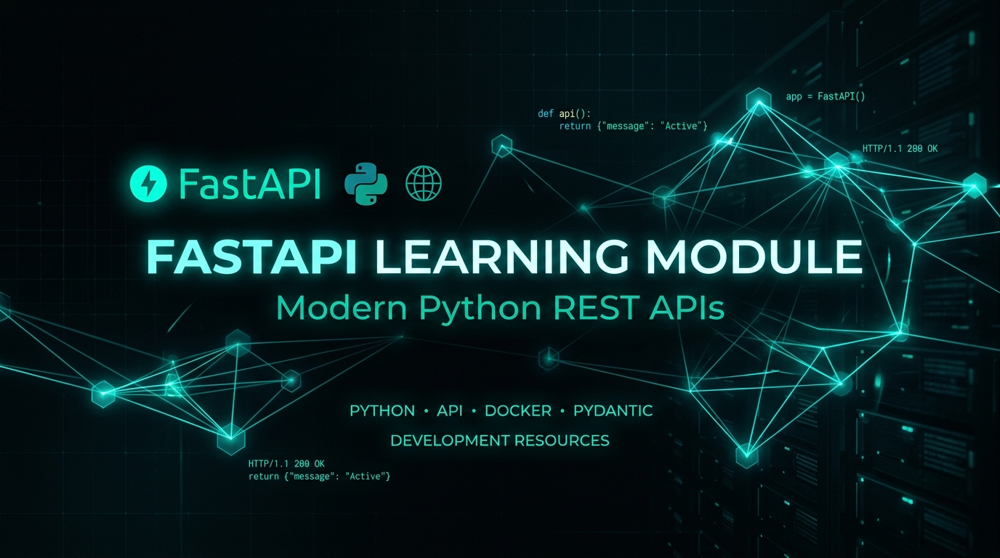
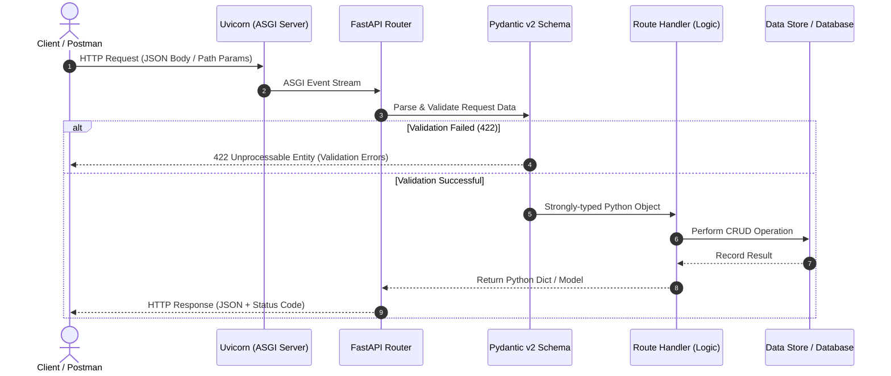

<p align="center">
  
</p>

<p align="center">
  <a href="https://fastapi.tiangolo.com/"></a>
  <a href="https://www.python.org/"></a>
  <a href="https://docs.pydantic.dev/"></a>
  <a href="https://www.uvicorn.org/"></a>
  <a href="https://www.postman.com/"></a>
  <a href="#license"></a>
</p>

<p align="center">
  <strong>A comprehensive, structured, and hands-on repository dedicated to mastering RESTful API development with modern Python, FastAPI, Pydantic V2, and Uvicorn.</strong>
</p>

---

## 📌 Table of Contents

- [🌟 Overview](#-overview)
- [⚡ Key Features](#-key-features)
- [🏗 Architecture & Request Flow](#-architecture--request-flow)
- [📂 Project Structure](#-project-structure)
- [🚀 Quick Start Guide](#-quick-start-guide)
  - [Prerequisites](#prerequisites)
  - [1. Clone Repository](#1-clone-repository)
  - [2. Virtual Environment Setup](#2-virtual-environment-setup)
  - [3. Install Dependencies](#3-install-dependencies)
  - [4. Launch the Server](#4-launch-the-server)
- [📡 API Endpoints Reference](#-api-endpoints-reference)
- [🧪 Testing the API](#-testing-the-api)
  - [Interactive Swagger UI](#interactive-swagger-ui)
  - [Testing with Postman / cURL](#testing-with-postman--curl)
- [🗺 Learning Modules & Roadmap](#-learning-modules--roadmap)
- [💡 Core Concepts & Best Practices](#-core-concepts--best-practices)
- [🤝 Contributing](#-contributing)
- [👤 Author](#-author)
- [📄 License](#-license)

---

## 🌟 Overview

FastAPI is a modern, high-performance web framework for building APIs with Python 3.8+ based on standard Python type hints. This repository serves as a **step-by-step learning module** capturing everything from building your very first HTTP endpoint to implementing schema-driven CRUD operations, error handling, and production-ready patterns.

### Why FastAPI?
- ⚡ **High Performance**: On par with **NodeJS** and **Go** (thanks to Starlette and Pydantic).
- 🚀 **Fast to Code**: Increases feature development speed by roughly 200% to 300%.
- 🛡 **Robust & Type-Safe**: Catch bugs early with automatic data validation and serialization.
- 📖 **Automatic Documentation**: Free interactive API docs powered by Swagger UI and ReDoc.

---

## ⚡ Key Features

- [x] **FastAPI Application Initialization** with custom metadata, title, and tags.
- [x] **Pydantic v2 Schema Modeling** using `BaseModel` and modern `model_dump()` serialization.
- [x] **Full CRUD Operations**:
  - `GET /` — Welcome & documentation entry points.
  - `GET /posts` — Retrieve all posts.
  - `GET /posts/{id}` — Retrieve a specific post with custom 404 validation.
  - `POST /posts` — Create a validated post with HTTP 201 Created status.
  - `PUT /posts/{id}` — Full update of an existing post.
  - `DELETE /posts/{id}` — Remove post with HTTP 204 No Content status.
- [x] **HTTP Status Code Management**: Proper semantics using `fastapi.status` (`200 OK`, `201 Created`, `204 No Content`, `404 Not Found`).
- [x] **Automatic OpenAPI Schema**: Instant access to `/docs` (Swagger UI) and `/redoc` (ReDoc).

---

## 🏗 Architecture & Request Flow



---

## 📂 Project Structure

```text
Python API Development/
├── assets/
│   └── banner.png             # Professional repository banner image
├── apidev/                    # Python virtual environment (ignored in git)
├── .gitignore                 # Standard Python gitignore rules
├── main.py                    # Core FastAPI application & CRUD routes
├── requirements.txt           # Application dependencies
└── README.md                  # Project documentation & learning guide
```

---

## 🚀 Quick Start Guide

Follow these steps to get your local development environment running in under 2 minutes:

### Prerequisites
- **Python 3.10+** installed on your system. ([Download Python](https://www.python.org/downloads/))
- **Git** installed on your system.

### 1. Clone Repository
```bash
git clone https://github.com/udityamerit/Python-API-Development.git
cd "Python-API-Development"
```

### 2. Virtual Environment Setup

#### On Windows (PowerShell):
```powershell
# Create virtual environment
python -m venv apidev

# Activate virtual environment
.\apidev\Scripts\Activate.ps1
```

> **Note for PowerShell execution policy**: If activation is restricted, run:  
> `Set-ExecutionPolicy -ExecutionPolicy RemoteSigned -Scope CurrentUser`

#### On macOS / Linux:
```bash
# Create virtual environment
python3 -m venv apidev

# Activate virtual environment
source apidev/bin/activate
```

### 3. Install Dependencies
```bash
pip install --upgrade pip
pip install -r requirements.txt
```

### 4. Launch the Server
Start the ASGI web server with live reload enabled:
```bash
uvicorn main:app --reload
```

Server output will confirm:
```text
INFO:     Uvicorn running on http://127.0.0.1:8000 (Press CTRL+C to quit)
INFO:     Started reloader process
INFO:     Started server process
INFO:     Application startup complete.
```

---

## 📡 API Endpoints Reference

| Method | Endpoint | Description | Request Body | Success Code | Error Code |
| :--- | :--- | :--- | :--- | :--- | :--- |
| `GET` | `/` | Root welcome & metadata | *None* | `200 OK` | — |
| `GET` | `/posts` | Fetch all posts | *None* | `200 OK` | — |
| `GET` | `/posts/{id}` | Fetch a post by ID | *None* | `200 OK` | `404 Not Found` |
| `POST` | `/posts` | Create a new post | `PostCreate` (JSON) | `201 Created` | `422 Unprocessable` |
| `PUT` | `/posts/{id}` | Update an existing post | `PostCreate` (JSON) | `200 OK` | `404 Not Found` |
| `DELETE` | `/posts/{id}` | Delete a post by ID | *None* | `204 No Content`| `404 Not Found` |

### Sample Request Payloads & Responses

#### 1. Create a Post (`POST /posts`)
**Request Body (`application/json`):**
```json
{
  "title": "Mastering FastAPI",
  "content": "FastAPI combined with Pydantic v2 offers unmatched developer experience and speed.",
  "published": true,
  "rating": 5
}
```

**Response (`201 Created`):**
```json
{
  "data": {
    "title": "Mastering FastAPI",
    "content": "FastAPI combined with Pydantic v2 offers unmatched developer experience and speed.",
    "published": true,
    "rating": 5,
    "id": 84210
  }
}
```

#### 2. Get Post by ID (`GET /posts/1`)
**Response (`200 OK`):**
```json
{
  "data": {
    "id": 1,
    "title": "Welcome to FastAPI",
    "content": "FastAPI is a modern, high-performance web framework for Python.",
    "published": true,
    "rating": 5
  }
}
```

---

## 🧪 Testing the API

### Interactive Swagger UI
Once your server is running, open your browser and navigate to:
- 🔗 **Swagger UI**: [http://127.0.0.1:8000/docs](http://127.0.0.1:8000/docs)
- 🔗 **ReDoc**: [http://127.0.0.1:8000/redoc](http://127.0.0.1:8000/redoc)

Swagger UI allows you to execute requests directly inside your browser with live response preview.

### Testing with Postman / cURL

#### cURL Example: Create Post
```bash
curl -X POST "http://127.0.0.1:8000/posts" \
     -H "Content-Type: application/json" \
     -d '{"title": "Testing via cURL", "content": "Fast and lightweight!", "published": true, "rating": 5}'
```

#### cURL Example: Get All Posts
```bash
curl -X GET "http://127.0.0.1:8000/posts"
```

---

## 🗺 Learning Modules & Roadmap

This repository follows a structured curriculum for end-to-end Python API development:

```
├── [x] Module 01: Setup & Virtual Environments (venv, pip, uvicorn)
├── [x] Module 02: First Steps & Path Operations (GET, POST, Status Codes)
├── [x] Module 03: Request Bodies & Schema Validation (Pydantic v2)
├── [x] Module 04: Complete In-Memory CRUD Operations (Create, Read, Update, Delete)
├── [x] Module 05: Path vs Query Parameters & Robust 404 Exception Handling
├── [ ] Module 06: Relational Databases with PostgreSQL & psycopg / asyncpg
├── [ ] Module 07: Object Relational Mapping (SQLAlchemy ORM)
├── [ ] Module 08: Database Migrations with Alembic
├── [ ] Module 09: User Authentication, Password Hashing & JWT Tokens
├── [ ] Module 10: Router Modularization (APIRouter) & Project Architecture
├── [ ] Module 11: Unit & Integration Testing with Pytest
└── [ ] Module 12: Containerization with Docker & Cloud Deployment
```

---

## 💡 Core Concepts & Best Practices

### 1. Pydantic v2 Migration: `model_dump()` vs `dict()`
In Pydantic v1, converting a schema model to a dictionary used `.dict()`.  
In **Pydantic v2**, the official and performant method is **`.model_dump()`**:
```python
# Pydantic v2 (Current standard)
post_dict = new_post.model_dump()

# Avoid legacy v1 syntax:
# post_dict = new_post.dict()  # Deprecated in v2
```

### 2. Path Operation Order Matters
FastAPI evaluates route matches in the exact order they are declared in code. Always declare specific routes **before** parameterized routes:
```python
# CORRECT:
@app.get("/posts/latest")
def get_latest_post():
    ...

@app.get("/posts/{id}")
def get_post(id: int):
    ...

# INCORRECT:
# If /posts/{id} is above /posts/latest, FastAPI will treat "latest" as an integer ID
# and return an HTTP 422 Unprocessable Entity error!
```

### 3. Use Semantic Status Codes
Always prefer explicit HTTP status codes:
```python
from fastapi import status

@app.post("/posts", status_code=status.HTTP_201_CREATED)
@app.delete("/posts/{id}", status_code=status.HTTP_204_NO_CONTENT)
```

---

## 🤝 Contributing

Contributions, feedback, and suggestions are welcome!

1. Fork the Project (`gh repo fork udityamerit/Python-API-Development`)
2. Create your Feature Branch (`git checkout -b feature/AmazingFeature`)
3. Commit your Changes (`git commit -m 'Add some AmazingFeature'`)
4. Push to the Branch (`git push origin feature/AmazingFeature`)
5. Open a Pull Request

---

## 👤 Author

**Uditya Narayan Tiwari**
- GitHub: [@udityamerit](https://github.com/udityamerit)
- Email: [uditmerit@gmail.com](mailto:uditmerit@gmail.com)

---

## 📄 License

This project is licensed under the **MIT License** — see the [LICENSE](LICENSE) file for details.

<p align="center">
  <sub>Built with ❤️ and FastAPI • Made for developers mastering Python Web APIs</sub>
</p>
